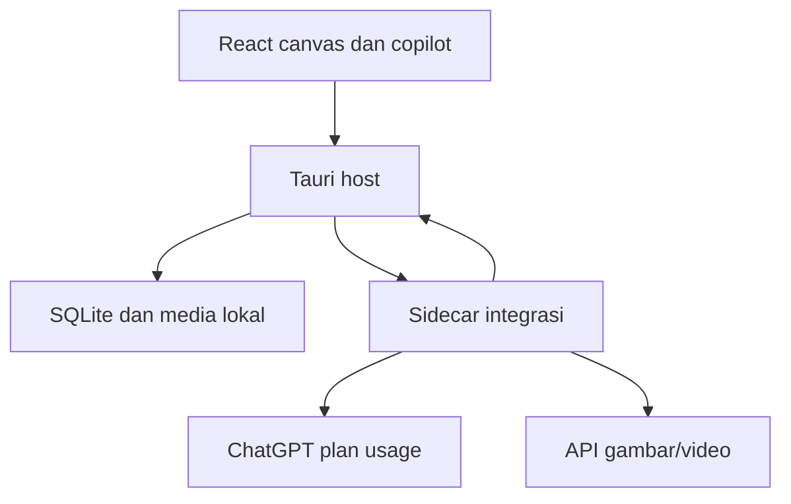

# Arsitektur — Aluraya

**Arsitektur aktif 16 Oktober 2026 — ADR-016:** React merender canvas terpadu dan Copilot kanan. Profil API nonrahasia disimpan lokal melalui schema Zod. Routing LLM/gambar/video terpisah. Adapter Nexabot, IPC, capability dan akses asset protocol-nya dihapus; Flow tetap tidak aktif.

Target eksekusi berikut: UI → use case/approval host → adapter protokol sidecar → API pengguna. Key hanya di secure store native, tidak diteruskan kembali ke renderer; URL, mapping, kapasitas, biaya dan snapshot harus divalidasi ulang pada boundary native. Adapter LLM mengembalikan proposal, bukan mutasi proyek langsung. Adapter media mengembalikan job/hasil yang diikat projectId/shotId/revision. HTTP generik tidak dijalankan dari renderer. Kontrak saat ini belum menyediakan executor. Baca [API-PROVIDERS](docs/API-PROVIDERS.md).

## Rancangan awal dan checkpoint historis
Catatan di bawah menjelaskan evolusi desain; bagian Flow tidak berlaku sebagai runtime aktif.

## Rekomendasi dan batas
Tauri 2 + React/TypeScript untuk shell/canvas pada laptop RAM 8 GB. Satu sidecar Node/TypeScript untuk adapter ChatGPT dan API provider terpilih; SQLite lokal untuk state; media disimpan sebagai file. Rekomendasi bersifat provisional sampai M-001 membuktikan packaging dan integrasi. Tidak ada backend cloud, Redis, Kubernetes, atau microservices.

## Proses runtime

WebView aplikasi hanya merender UI lokal. Google login/Flow memakai browser khusus terpisah; jangan memuat situs remote dengan hak akses filesystem aplikasi. Domain tidak bergantung pada Tauri, React, Playwright atau SQL.

## Modul dan kepemilikan
| Modul | Tanggung jawab tunggal | Kontrak / data |
|---|---|---|
| project | Proyek, naskah, mode adaptasi | Project, ScriptRevision |
| canvas | Layout dan seleksi tampilan | CanvasNode, CanvasEdge |
| assets | Versi media dan referensi | Asset, AssetRevision |
| planning | Shot, kontinuitas, validasi rencana | ShotRevision, Dependency |
| approvals | Validasi persetujuan terhadap snapshot | Approval |
| jobs | Antrean, lease, state dan rekonsiliasi | Job, Attempt |
| accounts | Profil, capabilities, saldo | ProviderAccount, CreditObservation |
| copilot | Konteks dan proposal tool | Conversation, Proposal |
| media | Validasi file, thumbnail, last frame, ekspor | MediaFile |
| chatgpt-adapter | OAuth, model discovery, streaming | ChatAgentPort |
| media-adapter (rencana) | Request/poll/download sesuai provider | GenerationPort |

Susunan yang direncanakan: `src/features/<feature>/` untuk UI; `src/contracts/` untuk DTO tervalidasi; `src-tauri/src/application/`, `domain/`, `infrastructure/` untuk host; `sidecar/src/chatgpt/`, `flow/`, `transport/` untuk integrasi. Path ini belum berupa source yang telah dibuat. Registry hanya wiring, bukan semua logika dalam satu file.

Host adalah satu-satunya penulis database. Sidecar mengirim event tervalidasi melalui stdio JSON berframing; tidak membuka port kontrol publik. Host menyimpan event dan state secara atomik sebelum memberi tahu UI. Format transport dan ukuran maksimum pesan dibatasi; media lewat referensi file yang divalidasi, bukan base64 besar dalam event.

## Alur ChatGPT
Login resmi dengan browser sistem; izin identity dan plan usage diperiksa terpisah. Token disimpan melalui fasilitas OS/penyimpanan terenkripsi, tidak dikirim ke React. Konteks chat tersimpan lokal dan disusun ulang sesuai jalur API yang didukung. Model berasal dari discovery, bukan nama model hardcoded. Proposal tool tidak langsung mengeksekusi generasi: host memvalidasi schema, proyek, scope dan approval.
Penggunaan paket tidak memberi akses otomatis ke riwayat chat akun. Tidak ada API key berbayar fallback. Kuota habis -> pause; kontrol penggunaan diarahkan ke pengaturan resmi. Opsi penggunaan kredit tambahan tidak diaktifkan oleh aplikasi; verifikasi setting akun selama setup.
Keterbatasan preview resmi (diperiksa 11 Oktober 2026): jalur plan usage tidak mendukung tool image generation atau input audio/video. Gunakan adapter media terpisah untuk gambar/video dan review manusia untuk audio. Deteksi visual opsional hanya dari frame yang diekstrak; bukan bukti kualitas audio.

## Alur Flow otomatis
GenerationPort harus membuktikan kemampuan berikut: inspectCapabilities, observeCredits, prepareReferences, submit, reconcile, observeStatus, collectOutputs. Nama ini kontrak internal; bukan klaim endpoint Google tersedia.
1. Host membekukan input, memvalidasi persetujuan, dependensi, saldo segar, model, dan reservasi kredit.
2. Simpan Attempt dengan status submitting sebelum UI provider menerima submit.
3. Adapter menjalankan UI pada profil milik pengguna dan merekam ID job/proyek/result jika tersedia.
4. Jika submit terkonfirmasi -> submitted; timeout ambigu -> uncertain; tidak mengirim ulang otomatis.
5. Pantau hasil; unduh ke file sementara; validasi MIME, ukuran, metadata, hash; rename atomik; simpan MediaFile dan event siap canvas.
6. Jika download gagal, ulangi pengambilan hasil yang sama. Jangan generate ulang.

Tidak menjanjikan browser selalu tersembunyi. Login/captcha dapat memerlukan browser terlihat; setelah itu proses produksi otomatis. Jangan membuat bypass captcha, fingerprint stealth, atau memakai endpoint privat yang belum diotorisasi. Periksa jalur yang diizinkan dan capability aktual saat M-001; tidak ada jaminan Google login menerima setiap konfigurasi automation.

## Penjadwal akun dan kredit
Default satu job dan satu profil aktif. Simpan banyak akun, buka hanya yang bekerja. Round robin setelah filter kemampuan, autentikasi, saldo segar dan sisa reservasi. Biaya bisa berbeda antarplan; hitung ulang saat akun berganti dan jangan melampaui approval. Jika akun berbagi credit pool, reservasi di pool yang sama. Pool unknown tidak boleh diasumsikan independen ketika paralelisme diaktifkan.
Reference lokal memungkinkan pindah akun, tetapi ID proyek/media provider mungkin account-scoped; upload ulang bila perlu. Continuity menunggu frame dari accepted revision, bukan latest attempt sembarang. Rate limit mengikuti retry-after; jangan memakai pergantian akun untuk menghindari pembatasan akses provider.

## Ketahanan dan sumber daya
Lease job tersimpan, hanya satu pemilik dispatcher. Saat restart, lease expired -> reconciliation. SQLite WAL dan transaksi pendek; tidak menyimpan blob video di DB. Thumbnail, culling node, player lazy, dan backpressure membatasi RAM. FFmpeg proses terpisah dihentikan setelah selesai. Ukur seluruh process tree termasuk browser dan WebView2.
Backup: SQLite consistent backup ditambah media manifest/hash; rahasia dan browser profile tidak ikut. Disk penuh menahan download tanpa kehilangan provider result. Browser crash tidak mematikan UI.

## Distribusi
Target Windows x64. Installer mengemas Tauri, UI, sidecar, runtime sidecar dan binary media yang lisensinya sudah diperiksa; WebView2 prerequisite diperiksa. Tidak menyertakan browser profile/token. Update manual di MVP; signing/distribusi publik di luar cakupan awal. CI tanpa akun nyata; live provider hanya pada perangkat pengguna dengan batch disetujui.

## Referensi resmi dan batas bukti
- https://v2.tauri.app/start/ — shell memakai WebView sistem; bukan benchmark total aplikasi.
- https://v2.tauri.app/develop/sidecar/ — pengemasan executable pendamping.
- https://reactflow.dev/learn — canvas node/edge.
- https://playwright.dev/docs/auth — state autentikasi sensitif.
- https://developers.openai.com/cookbook/articles/sign-in-with-chatgpt — integrasi proyek pribadi lokal.
- https://developers.openai.com/siwc/token-sharing-open-source/preview-limitations — batas jalur plan usage.
- https://support.google.com/flow/answer/16526234?hl=en — saldo dan biaya; tidak membuktikan API automation publik.
Semua referensi diperiksa 11 Oktober 2026; revalidasi saat implementasi. Tidak ada live integrasi yang sudah diuji.

## Pipeline compiler prompt (REQ-016)
Planner menghasilkan struktur, bukan hanya satu string panjang. Application service `PromptCompiler` menggabungkan versi Script/Shot/Style/ReferenceManifest dan capability snapshot menjadi empat dokumen sesuai jenis tugas. Modul `PromptLint` memvalidasi struktur dan konflik sebelum review. Compiler pure dan dapat diuji tanpa provider; adapter provider menerjemahkan label reference ke input UI yang benar-benar didukung.

Alur: intent produksi -> structured plan -> manifest role/revision -> capability validation -> prompt render -> lint -> preview pengguna -> snapshot approval -> upload dalam urutan manifest -> submit. Hash mencakup teks hasil edit, versi compiler/template/style, manifest lengkap, model/capability dan konfigurasi. Edit manual ditandai `needs_validation`; metadata terstruktur tidak boleh diam-diam dianggap masih cocok dengan teks bebas yang berubah.
ReferenceN bersifat lokal per invocation. Karakter yang Reference4 pada board dapat Reference3 pada video; mapping berasal dari role+ID, bukan asumsi angka global. Manifest selalu terlihat di UI. File storyboard bukan first frame. Jika model hanya menerima start frame, ambil frame tunggal yang disetujui atau ubah rencana; jangan otomatis kirim sembilan panel ke slot start frame.

Style profile dipisah menjadi rendering/warna/tekstur bersama, pencahayaan per task, dan kamera per shot. Character Card mengutamakan wajah/wardrobe terbaca; scene plate keterbacaan ruang; storyboard ritme shot; video gerak/waktu/audio. Hindari menempel seluruh kalimat style identik ke semua tugas jika menghasilkan konflik. Preferensi ilustrasi/animasi lama tidak mengalahkan gaya live-action yang dipilih proyek ini.

Tidak mengasumsikan Gemini/Flow menerima token `@Reference1` secara literal. Adapter merender label yang sesuai dan memverifikasi attachment order/capacity. Capability model yang tidak mendukung jumlah referensi menahan batch dan menawarkan rencana baru untuk disetujui; jangan membuang referensi diam-diam.

## Status kode checkpoint M-001

Sudah ada `src/features/canvas`, `copilot`, `diagnostics`, `src/application`, `src/contracts`, `src-tauri/src/application`, `src-tauri/src/infrastructure`, dan `sidecar/src/transport`. Saat ini host hanya menjalankan diagnostik read-only. Semua modul produksi pada tabel di atas tetap target arsitektur; belum ada DB, OAuth, Flow adapter, approval atau scheduler. Kontrak terbatas saat ini: [docs/IPC.md](./docs/IPC.md).

## Checkpoint TASK-003

Adapter `sidecar/src/chatgpt` memisahkan OAuth, token/identity, protected store, HTTP/SSE dan session coordinator. Kredensial bukan database proyek: disimpan lokal terenkripsi DPAPI, hanya sidecar yang menggunakannya, dan host memegang lock OS eksklusif. Snapshot publik melewati DTO Rust/TypeScript; tidak memuat rahasia. Percakapan sementara in-memory, satu operasi aktif, polling UI selama aktivitas. Batas sementara dan bukti live yang belum dijalankan tercatat di docs/CHATGPT-START.md. Modul produksi/SQLite masih menunggu gate M-001.

## Checkpoint TASK-004 — profil Flow

`sidecar/src/flow` memisahkan daftar profil lokal, browser, pembacaan label dan coordinator. Host mengirim root app-local/flow melalui environment tepercaya; React hanya boleh mengirim UUID profil dan pilihan chrome/msedge. Satu persistent browser context aktif, pipe Playwright standar, tanpa port kontrol TCP, tanpa default profile import, stealth atau endpoint Google privat. Registry profil merupakan metadata koneksi di sidecar, bukan database proyek. Browser melindungi sesi profil menurut fasilitas OS; profil tidak diekspor.

Observasi hanya pada origin/path Flow yang diizinkan, tidak pada Google login; URL query dan isi kredensial tidak diteruskan. Teks model/kredit hanya kandidat dengan batas ukuran, tidak pernah otorisasi produksi. Penutupan host memberi EOF dan menunggu sampai dua detik sebelum fallback kill sidecar; penutupan browser Windows aktual setelah crash tetap perlu bukti. Playwright disertakan utuh sebagai dependensi eksternal agar file runtime dinamis tersedia.

## Pembaruan TASK-004 — 14 Oktober 2026

Browser Flow kini dimiliki host Rust/Tauri melalui WebView2 pada Windows. Ketentuan lama bahwa semua halaman remote harus dibuka pada browser eksternal digantikan untuk jendela Flow khusus: jendela remote tidak menerima capability IPC, tidak boleh menavigasi ke origin aplikasi lokal, dan tidak memiliki bridge generik untuk filesystem/shell. UI studio lokal tetap terpisah. Sidecar hanya melayani ChatGPT/diagnostik; route Flow dan Playwright dihapus. Sesi profil baru memakai direktori flow-webview2 dan lock eksklusif. Popup mewarisi environment pembuka melalui window_features. Pola ini mengacu pada Switchly tanpa mengambil data atau sesi Switchly.

Observasi awal hanya URL-classification; tidak membaca DOM login, token atau cookie. API tidak menerima perintah Generate dan generationReady selalu false. Pengendalian produksi otomatis tetap target REQ-007, menunggu bukti login/capability/biaya dan approval. Ini kandidat kompatibilitas, bukan klaim dukungan provider atau keberhasilan live.

## Editor draf frontend — ADR-015
`src/domain/studio.ts` memiliki schema dan aturan review draf. `src/infrastructure/studioStorage.ts` menyimpan proyek ke IndexedDB lokal (`aluraya-studio-drafts`, store `projects`), membaca referensi JPG/PNG/WebP, dan impor/ekspor JSON. `src/features/studio/useStudio.ts` mengantrekan penulisan dan melaporkan gagal simpan per proyek. Komponen editor, canvas, inspector, koneksi dan review terpisah. Tidak ada token/key dalam draf. Native database proyek tetap pekerjaan berikut; IndexedDB bukan jurnal produksi native. Browser preview dan WebView desktop memiliki storage masing-masing; pindahkan draf dengan JSON, bukan menganggap keduanya sinkron.
